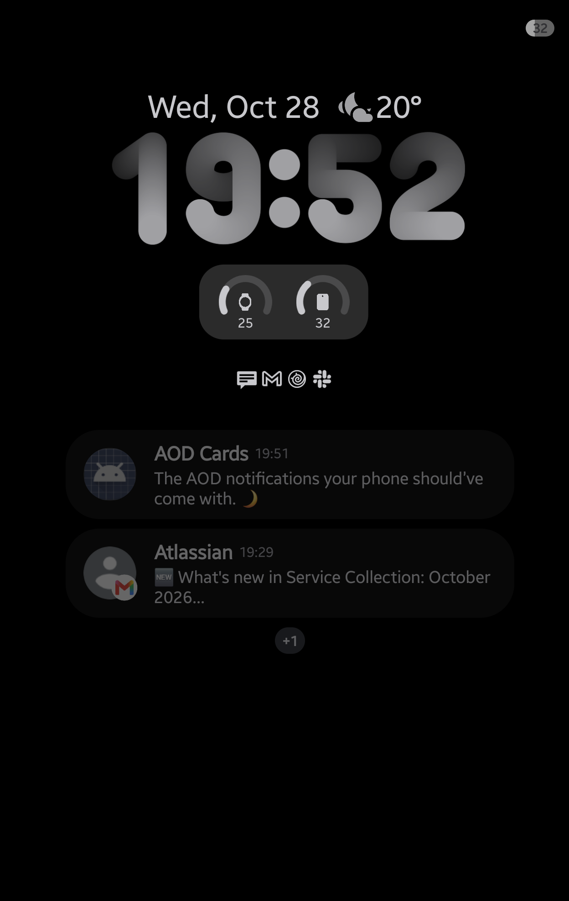
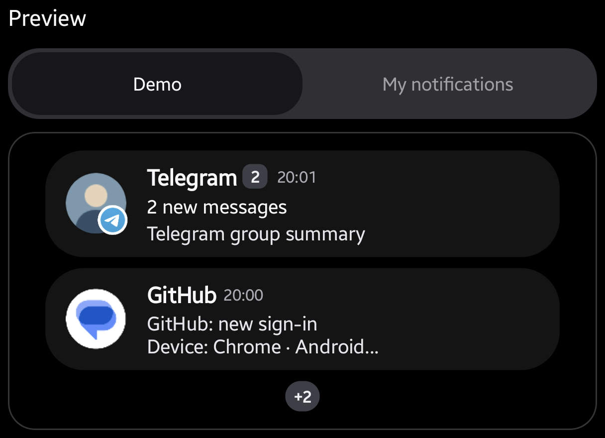

<div align="center">


# AOD Cards

**The AOD notifications your phone should’ve come with. 🌙**

Notification and music cards for Samsung Always On Display.

**Android 16+ · Good Lock / LockStar**



</div>

> **Provided as is.** Use it at your own discretion; compatibility and reliability are not guaranteed.
>
> **Built for my own phone.** I made this with AI assistance for my Samsung Galaxy Z Fold8. Behavior on other devices, firmware, or LockStar versions may differ.

## At a glance

- **Designed to feel native** — notification cards styled to match Samsung One UI as closely as possible.
- **Your layout** — choose how much screen space your widget takes up.
- **Your content** — show full text, just the sender, or only the app; exclude apps you don’t need.
- **Live preview** — adjust the look using your notifications or built-in demo content.

<p align="center">
  
</p>

Cards appear while the screen is off. You can also keep them visible when the screen is on. Notification cards do not open individual notifications. The optional **Widget → Behavior → Unlock on tap** setting requests system unlock when you tap the live widget. It is enabled by default; only unlock animations started from the widget may be broken. Android still requires authentication when the device is locked. Taps in the in-app preview do nothing.

## Get started

You’ll need a Samsung device running **Android 16 (API 36) or later**, plus **Good Lock / LockStar** with support for third-party AOD widgets. Availability depends on your firmware and LockStar version.

1. Install the APK and open **AOD Cards**.
2. On the **Access** tab, grant notification access and disable battery optimization to allow the app to run in the background.
3. Open **Good Lock → LockStar → Always On Display** and add **AOD Cards**.
4. Customize the appearance on the **Widget** tab and excluded apps on the **Filter** tab.

> **Empty LockStar preview?** Enable **Show notifications when the screen is on** in AOD Cards while placing the widget. You can turn it off afterward.

## Known issues

- **Widget dimming.** LockStar automatically dims the widget on Always On Display. This behavior cannot be adjusted in AOD Cards.
- **Touch gestures over the widget.** The unstable **Unlock on tap** setting only works if LockStar forwards the tap. Only unlock animations started from the widget may be broken. Swipes and double-taps are handled by LockStar; the app cannot forward these gestures to the system. AOD touch behavior needs testing on your device.
- **Blank widget.** The widget may occasionally appear empty. Removing it and adding it again can help. Bug reports are welcome.
- **Google Play Protect warning.** Google Play Protect may flag the provided APK as dangerous. If you don’t trust the provided APK, you can [build it from source](#build).

## Privacy

Notification data stays on your device and is not saved to disk by the app. No telemetry, analytics, tracking, or other data collection beyond what’s needed to display your notifications. How notifications appear may differ from your system privacy settings.

For example, if you don’t want attachments or notification details to appear, explicitly disable them in the widget settings.

## Build

Use **JDK 17+** (verified locally with JDK 20), **Android SDK Platform 37**, and **Build Tools 37.0.0**. Set `ANDROID_HOME` or `sdk.dir` in `local.properties`.

```sh
./gradlew assembleDebug
```

APK: `app/build/outputs/apk/debug/app-debug.apk`. On Windows, use `gradlew.bat`.

<details>
<summary>Checks</summary>

```sh
./gradlew assembleDebugAndroidTest lintDebug
```

To run the regression suite on a connected API 36+ device:

```sh
adb install -r app/build/outputs/apk/debug/app-debug.apk
adb install -r app/build/outputs/apk/androidTest/debug/app-debug-androidTest.apk
adb shell am instrument -w com.aodcards.test/com.aodcards.RegressionInstrumentation
```

Visual checks require a visible app window. Actual AOD behavior and battery usage need separate testing on a Samsung device.

</details>
